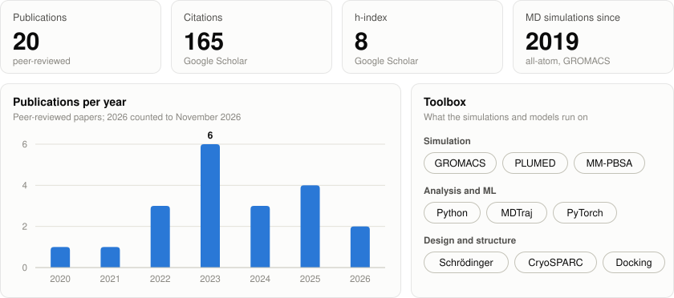

# Tushar Kushwaha, Ph.D.

**Computational structural biologist · molecular dynamics · machine learning for protein design**

Department of Biophysics, All India Institute of Medical Sciences (AIIMS), New Delhi

[Google Scholar](https://scholar.google.com/citations?user=lOX2HpIAAAAJ&hl=en) · [LinkedIn](https://www.linkedin.com/in/tushar-k-89977116a)

<picture>
  <source media="(prefers-color-scheme: dark)" srcset="assets/dashboard-dark.svg">
  
</picture>

---

## About

I study how proteins move, bind and can be redesigned. Since 2019 I have run all-atom molecular dynamics on proteins in complex with small molecules, other proteins, nucleic acids and membranes, and that work sits behind 20 peer-reviewed papers on targets from SARS-CoV-2 proteases to tuberculosis and EGFR-driven lung cancer.

My Ph.D. was on engineering antibody-like monobody (FN3) binders against human EGFR, where I ran both the simulations and the bench work: protein purification, binding measurements and cell assays. That means I design computations knowing what the experiment can actually test.

**Now:** building an ML-guided pipeline for monobody binder design in PyTorch, carrying what MD taught me about interfaces and dynamics into learned models.

## What I work with

| Area | Tools and methods |
| --- | --- |
| Molecular dynamics | GROMACS, PLUMED (metadynamics), MM-PBSA free energies, protein–ligand, protein–protein, protein–nucleic acid and membrane systems |
| Trajectory analysis | Python, MDTraj, pandas, shell scripting |
| Machine learning | PyTorch, ML-guided protein binder design |
| Drug design | Docking, virtual screening, pharmacophore modelling, lead optimisation (Schrödinger suite and open-source tools) |
| Structure | Structure prediction, single-particle cryo-EM processing in CryoSPARC |
| Computing | Linux, HPC clusters |

## Code

- [GROMACS-simulation-analysis](https://github.com/TusharKush1/GROMACS-simulation-analysis): occupancy analysis of hydrogen bonds, salt bridges, hydrophobic, π–π and cation–π contacts from GROMACS trajectories, with PyMOL output

## Selected computational publications

- Kulandaisamy R, **Kushwaha T**, *et al.* In silico screening and molecular dynamics simulations of small molecules targeting peptidyl tRNA hydrolase for drug-resistant tuberculosis. *ACS Omega* (2025)
- Malik Z, **Kushwaha T**, *et al.* In silico analysis of CaM/Ca²⁺-dependent-like kinases of the protozoan parasite *Entamoeba histolytica*. *Biochemical & Cellular Archives* (2025)
- Dalal A, **Kushwaha T**, *et al.* Computational investigations on the potential role of hygrophorones as quorum sensing inhibitors against LasR protein of *Pseudomonas aeruginosa*. *Journal of Biomolecular Structure and Dynamics* (2023)
- Kulandaisamy R, **Kushwaha T**, *et al.* Repurposing of FDA approved drugs against SARS-CoV-2 papain-like protease: computational, biochemical, and in vitro studies. *Frontiers in Microbiology* (2023)
- Koley T, Roy Chowdhury S, **Kushwaha T**, *et al.* Deciphering the mechanism of p73 recognition of p53 response elements using the crystal structure of p73–DNA complexes and computational studies. *International Journal of Biological Macromolecules* (2022)
- Motiwale M\*, Yadav NS\*, Kumar S\*, **Kushwaha T**\*, *et al.* Finding potent inhibitors for COVID-19 main protease (Mpro): an in silico approach. *Journal of Biomolecular Structure and Dynamics* (2022) (\*joint first author)

Full list on [Google Scholar](https://scholar.google.com/citations?user=lOX2HpIAAAAJ&hl=en).

## Open to

Postdoctoral positions and collaborations in AI-driven protein design and structural biology.
